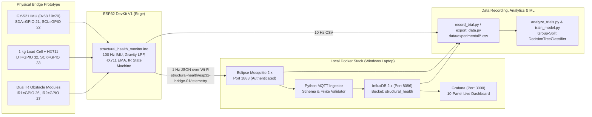

# Structural Health IoT Analytics

**Technical Focus:** Structural Vibration, Support-Reaction and Vehicle-Crossing Monitoring  
**Institution:** PES University  
**Course:** Internet of Things — `UE24CS342AA3`  
**GitHub Repository:** [https://github.com/pranav-atreya/structural-health-iot-analytics](https://github.com/pranav-atreya/structural-health-iot-analytics)

## Team Members

| Name | SRN | Role & Coordination |
|---|---|---|
| **Pranav Shashikiran Atreya** | `PES2UG24CS912` | Hardware assembly, ESP32 firmware setup & hardware-software integration |
| **Yash Raghavendra A** | `PES2UG24CS913` | Hardware assembly, physical bridge setup, load-cell mounting & sensor placement |
| **Hemaksh Breja** | `PES2UG24CS191` | Software backend, MQTT broker/ingestion pipeline & Grafana dashboard |
| **Kashyap V P** | `PES2UG24CS218` | Data validation, trial collection workflow, Python analytics & Decision Tree ML |

---

## 1. Project Overview & Objectives

This project implements a complete, end-to-end Internet of Things (IoT) monitoring and analytics pipeline for a tabletop bridge prototype constructed from an aluminium scale deck resting on cast-iron support blocks over a wooden base.

We apply static loads and pass a small toy vehicle across the bridge while monitoring three physical measurement channels:

1. **Structural Vibration & 6-Axis Motion (GY-521 IMU):** Sampled at ~100 Hz over I²C (`GPIO 21`/`22`), with on-device low-pass gravity removal to compute windowed dynamic vibration RMS (`vibration_rms_g`) and peak vibration (`vibration_peak_g`).
2. **Instrumented Support Reaction (Sharvi 1 kg Bar Load Cell + HX711):** Sampled non-blockingly (`GPIO 32`/`33`), providing raw, tare-relative net, and EMA-filtered counts at all times, and calibrated support reaction (`load_grams`) once calibrated with a known reference mass.
3. **Vehicle Detection, Direction & Crossing Count (Two Digital IR Obstacle Modules):** Sampled with 25 ms software debounce (`GPIO 26`/`27`) and a finite state machine to count vehicle crossings without double-counting, detect direction (`1_to_2` vs `2_to_1`), and optionally estimate speed when sensor spacing is configured.

> **Important Hardware Scope Note:** The VL53L0X Time-of-Flight (ToF) sensor has been officially dropped from the prototype. There is no direct displacement (`deflection_mm`) sensor in the final hardware.

---

## 2. System & Software Architecture

**Complete Data Flow:**  
`Physical Sensors → ESP32 DevKit V1 → Wi-Fi → Eclipse Mosquitto MQTT → Python Ingestion Service → InfluxDB 2.x → Grafana Dashboard → Python Analytics & Decision Tree ML`



---

## 3. Exact Hardware & Verified Pin Map

| Sensor / Module | Module Pin | ESP32 Pin | Details |
|---|---|---|---|
| **GY-521 IMU (MPU-6050 / MPU-6500)** | `VCC` / `GND` | `3V3` / `GND` | 3.3 V power, common ground |
| **GY-521 IMU (MPU-6050 / MPU-6500)** | `SDA` / `SCL` | `GPIO 21` / `GPIO 22` | I²C @ 100 kHz; accepts `WHO_AM_I` = `0x68` and `0x70` |
| **HX711 Load-Cell Amplifier** | `VCC` / `GND` | `3V3` / `GND` | 3.3 V logic supply |
| **HX711 Load-Cell Amplifier** | `DT` (`DOUT`) / `SCK` | `GPIO 32` / `GPIO 33` | Sharvi 1 kg 4-wire bar load cell (`Red=E+`, `Black=E-`, `Green=A+`, `White=A-`) |
| **IR Obstacle Sensor 1** | `OUT` (`VCC`/`GND`) | `GPIO 26` (`3V3`/`GND`) | Gate 1 (Entry); active `LOW` default, 25 ms debounce |
| **IR Obstacle Sensor 2** | `OUT` (`VCC`/`GND`) | `GPIO 27` (`3V3`/`GND`) | Gate 2 (Exit); active `LOW` default, 25 ms debounce |

---

## 4. Repository Structure

```text
structural-health-iot-analytics/
├── README.md
├── docker-compose.yml
├── requirements.txt
├── .env.example
├── .gitignore
├── firmware/
│   ├── README.md
│   ├── structural_health_monitor/
│   │   ├── structural_health_monitor.ino
│   │   └── secrets.example.h
│   └── hardware_compatibility_test/
│       └── hardware_compatibility_test.ino
├── backend/
│   └── mqtt_ingestor/
│       ├── Dockerfile
│       ├── requirements.txt
│       ├── validator.py
│       └── ingestor.py
├── docker/
│   ├── mosquitto/
│   │   ├── mosquitto.conf
│   │   └── entrypoint.sh
│   └── grafana/
│       ├── provisioning/
│       │   ├── datasources/influxdb.yml
│       │   └── dashboards/dashboards.yml
│       └── dashboards/
│           └── structural-health-dashboard.json
├── analytics-ml/
│   ├── README.md
│   ├── preprocess.py
│   ├── analyze_trials.py
│   ├── train_model.py
│   ├── predict.py
│   └── results/
├── data/
│   ├── sample/
│   │   ├── sample-format.csv
│   │   └── synthetic_trials.csv
│   └── experimental/
│       └── README.md
├── scripts/
│   ├── setup.ps1
│   ├── start_stack.ps1
│   ├── stop_stack.ps1
│   ├── record_trial.py
│   ├── export_data.py
│   ├── calibrate_load_cell.py
│   ├── generate_sample_data.py
│   └── publish_synthetic_test.py
├── tests/
│   └── test_pipeline.py
└── docs/
    ├── architecture.md
    ├── hardware-and-pin-map.md
    ├── data-dictionary.md
    ├── experiment-protocol.md
    ├── database-and-dashboard.md
    ├── ml-methodology.md
    ├── security.md
    ├── troubleshooting.md
    ├── demo-and-viva-guide.md
    └── team-responsibilities.md
```

---

## 5. Step-by-Step Windows / PowerShell Setup & Usage

### 5.1 Prerequisites
- **Windows 10/11** with **PowerShell**
- **Python 3.10+**
- **Docker Desktop for Windows** (running)
- **Arduino IDE 2.x** with the **ESP32 board package (`esp32` by Espressif Systems)** installed

### 5.2 Initial Workspace Setup
Open PowerShell in the repository root and run:

```powershell
.\scripts\setup.ps1
```

This script:
1. Copies `.env.example` → `.env` (if not already present).
2. Detects your laptop's active Wi-Fi LAN IPv4 address and creates `firmware\structural_health_monitor\secrets.h` from `secrets.example.h`.
3. Installs all required Python packages (`paho-mqtt`, `influxdb-client`, `python-dotenv`, `pyserial`, `pandas`, `numpy`, `matplotlib`, `scikit-learn`, `joblib`, `pytest`).

### 5.3 Start the Local Docker Stack (Mosquitto + InfluxDB + Ingestor + Grafana)
Make sure **Docker Desktop** is running, then execute:

```powershell
.\scripts\start_stack.ps1
```

Verify the pipeline end-to-end using a synthetic test packet:

```powershell
python scripts/publish_synthetic_test.py --verify-influx
```

### 5.4 Access the Grafana Dashboard & InfluxDB UI
- **Grafana Dashboard:** Open `http://localhost:3000`
  - **Username:** `admin` (from `.env`)
  - **Password:** `bridge_grafana_admin` (from `.env`)
  - Opens directly to **Structural Health IoT Analytics — Bridge Prototype Monitor** (10 panels).
- **InfluxDB 2.x UI:** Open `http://localhost:8086`
  - **Username / Password:** `admin` / `bridge_influx_admin_2026` (from `.env`)
  - **Org / Bucket:** `pes-iot` / `structural_health`

### 5.5 Flash the ESP32 Firmware
1. Open Arduino IDE and install two libraries via **Tools → Manage Libraries**:
   - **`HX711 Arduino Library`** by **Bogdan Necula (bogde)**
   - **`PubSubClient`** by **Nick O'Leary**
2. Edit `firmware/structural_health_monitor/secrets.h`:
   - Enter your 2.4 GHz `WIFI_SSID` and `WIFI_PASSWORD`.
   - Confirm `MQTT_BROKER_HOST` matches your laptop's Wi-Fi IPv4 address (shown by `ipconfig` or `.\scripts\start_stack.ps1`).
3. Open `firmware/structural_health_monitor/structural_health_monitor.ino` in Arduino IDE.
4. Select **Board:** `ESP32 Dev Module`, select your `COM` port, and click **Upload**.
5. Open **Serial Monitor** at `115200` baud to view hardware initialization, the 10 Hz CSV stream, and `[MQTT] Connected to broker ...`.

### 5.6 Load-Cell Tare & Calibration
- **Tare (Unloaded):** Press `T` + Enter in Serial Monitor with no extra weight on the bridge.
- **Calibrate with Known Mass:** Place a known reference mass (e.g., `100` g) over the instrumented support and send `C 100.0` in Serial Monitor, or run:
  ```powershell
  python scripts/calibrate_load_cell.py --known-mass-g 100.0 --net-counts 25660
  ```
  Copy the resulting `HX711_CALIBRATION_FACTOR` (`counts/g`) into `secrets.h` to persist it across reboots.

### 5.7 Record Experimental Trials & Export Data
```powershell
# Record a 30-second unloaded baseline trial from MQTT into data/experimental/
python scripts/record_trial.py --run-id EXP_BASE_01 --condition baseline --duration 30 --notes "Unloaded bridge deck"

# Record a 30-second static load trial (100 g at mid-span)
python scripts/record_trial.py --run-id EXP_LOAD_01 --condition static_load --applied-mass-g 100 --load-position "mid-span" --duration 30 --notes "100g mid-span"

# Record a 45-second dynamic vehicle-crossing trial
python scripts/record_trial.py --run-id EXP_CAR_01 --condition vehicle_crossing --load-position "1_to_2" --duration 45 --notes "Toy car passes 1->2"

# Export recent telemetry from InfluxDB to CSV
python scripts/export_data.py --last 30m --run-id EXP_EXPORT_01 --condition baseline

# Inspect and summarise any dataset
python scripts/export_data.py --inspect data/sample/synthetic_trials.csv
```

### 5.8 Run Analytics, Decision Tree ML Training & Prediction
```powershell
# 1. Generate comparative plots and trial/condition summaries
python analytics-ml/analyze_trials.py --data data/sample/synthetic_trials.csv

# 2. Train & evaluate the interpretable Decision Tree (group-split by run_id)
python analytics-ml/train_model.py --data data/sample/synthetic_trials.csv

# 3. Classify a new observation
python analytics-ml/predict.py --vibration-rms-g 0.075 --vibration-peak-g 0.210 --hx711-filtered-counts 4200 --ir1-state 0 --vehicle-crossing-delta 1

# 4. Run the full automated unit & integration test suite
python -m pytest -v
```

---

## 6. Known Limitations & Engineering Scope

1. **No Direct Deflection Measurement:** The VL53L0X ToF sensor was dropped; deck deflection (`deflection_mm`) is neither measured nor estimated.
2. **Single-Support Load Reaction:** The Sharvi 1 kg load cell is mounted at one support and therefore measures **support reaction at the instrumented support**, not total bridge load.
3. **Uncalibrated vs Calibrated Counts:** Until a verified reference mass is used to calibrate the load cell, the system reports raw, net, and filtered ADC counts and sets `load_grams = null`.
4. **Educational Scope of ML:** The `DecisionTreeClassifier` classifies controlled tabletop experimental conditions (`baseline`, `static_load`, `vehicle_crossing`). It does **not** predict real-world bridge failure or certify structural safety.
5. **Local Lab Security:** MQTT runs over local Wi-Fi TCP port `1883` with username/password authentication (`bridge_iot`), while InfluxDB (`127.0.0.1:8086`) and Grafana (`127.0.0.1:3000`) are restricted to localhost. See [docs/security.md](docs/security.md) for TLS/cloud hardening details.
