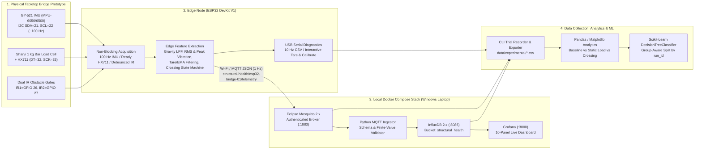

# System & Software Architecture — Structural Health IoT Analytics

**Project:** Structural Health IoT Analytics  
**Course:** Internet of Things (UE24CS342AA3) — PES University  
**Team:**
- Pranav Shashikiran Atreya — PES2UG24CS912
- Yash Raghavendra A — PES2UG24CS913
- Hemaksh Breja — PES2UG24CS191
- Kashyap V P — PES2UG24CS218

---

## 1. End-to-End Architecture Overview

The system monitors a tabletop bridge-like prototype constructed from an aluminium scale deck resting on a wooden base and cast-iron support blocks, with one support instrumented by a 1 kg bar load cell.

---

## 2. Five-Stage IoT Pipeline Mapping

| IoT Stage | Implementation in This Project |
|---|---|
| **1. Sense** | Three verified physical sensor groups: (a) GY-521 6-axis IMU for deck vibration/acceleration, (b) Sharvi 1 kg bar load cell + HX711 for support-reaction response at one support, and (c) two digital IR obstacle modules (`GPIO 26`, `GPIO 27`) for vehicle detection, direction, and crossing counts. *(The VL53L0X ToF sensor was officially dropped.)* |
| **2. Ingest** | ESP32 publishes 1 Hz JSON telemetry packets over Wi-Fi to the Eclipse Mosquitto MQTT broker (`structural-health/esp32-bridge-01/telemetry`) while maintaining a 10 Hz Serial CSV stream. |
| **3. Process** | **Edge:** ESP32 removes stationary gravity via a low-pass baseline filter ($\alpha = 0.02$ at 100 Hz) to compute dynamic vibration RMS and peak, computes tare-relative net and EMA-filtered HX711 counts, and runs a debounced two-sensor crossing state machine. **Backend:** Python ingestor validates JSON schema, rejects `NaN`/`Infinity`, and attaches server-side UTC timestamps. |
| **4. Store** | InfluxDB 2.x stores time-series points in the `structural_health` bucket (`bridge_telemetry` measurement) backed by persistent Docker volumes, alongside structured trial CSV files under `data/experimental/`. |
| **5. Analyze** | Grafana visualizes 10 live panels; Python scripts (`analyze_trials.py`, `train_model.py`, `predict.py`) generate comparative plots and train an interpretable `DecisionTreeClassifier` using group-aware train/test splitting by `run_id`. |

---

## 3. PES University Course Alignment (`UE24CS342AA3`)

### Unit 1 — Sensors and Embedded Logic
- **Microcontroller Architecture:** ESP32 DevKit V1 dual-core MCU running deterministic non-blocking `micros()`/`millis()` scheduling so 100 Hz IMU acquisition never blocks on Wi-Fi or serial I/O.
- **I²C Bus Protocol:** Low-level register communication (`Wire.h` at 100 kHz on `GPIO 21`/`22`) reading `WHO_AM_I` (`0x75`), configuring sample rate divider (`0x19 = 9`), DLPF (`0x1A = 0x03`), gyro range (`0x1B = 0x08`, $\pm 500^\circ/\text{s}$), and accel range (`0x1C = 0x08`, $\pm 4\,g$), and burst-reading 14 bytes from `0x3B`. Accepts both `0x68` and `0x70` chip IDs honestly.
- **Synchronous Serial ADC Interface:** HX711 two-wire clock/data protocol (`GPIO 32` DOUT, `GPIO 33` SCK) reading 24-bit signed strain-gauge bridge conversions non-blockingly via `scale.is_ready()`.
- **Digital GPIO & State Machine:** Software debouncing (`25 ms`) and transition detection on `GPIO 26` and `GPIO 27` feeding a directional finite state machine (`CROSSING_IDLE`, `CROSSING_1_TO_2_PENDING`, `CROSSING_2_TO_1_PENDING`, `CROSSING_WAIT_CLEAR`).

### Unit 2 — Connectivity and Protocols
- **IEEE 802.11 Wi-Fi Station Mode:** Automatic non-blocking reconnection (`WiFi.setAutoReconnect(true)` + 10 s retry interval) so sensor acquisition is never halted if Wi-Fi drops.
- **MQTT Publish/Subscribe Architecture:** Lightweight brokered messaging over TCP port `1883` using `PubSubClient` with hierarchical topic naming (`structural-health/<device_id>/telemetry`), client keep-alive, and username/password authentication.

### Unit 3 — Edge Analytics and Cloud/Data Integration
- **Edge vs Backend Processing:** High-rate 100 Hz vibration samples are reduced on the ESP32 into 1 Hz summary features (`vibration_rms_g`, `vibration_peak_g`), reducing network bandwidth by ~99% while preserving dynamic peak and energy metrics.
- **Time-Series Database & Visualization:** InfluxDB 2.x stores indexed tags (`device_id`, `imu_chip`, `calibrated`, `data_source`) and typed fields; Grafana queries InfluxDB via Flux every 2 seconds.
- **Interpretable ML Layer:** `DecisionTreeClassifier` classifies experimental operating conditions (`baseline`, `static_load`, `vehicle_crossing`) with group-aware splitting by `run_id`.
- **Cloud Extension Path:** Because ingestion is decoupled via standard MQTT topics, pointing `MQTT_BROKER_HOST` to a cloud broker (e.g., HiveMQ Cloud, AWS IoT Core, or an EC2 Docker host with TLS on port `8883`) extends the exact same firmware and backend to the cloud without modifying sensor logic.

### Unit 4 — IoT Security
- **Credential Isolation:** Wi-Fi, MQTT, InfluxDB, and Grafana secrets are stored exclusively in `.gitignore`-protected local files (`secrets.h` and `.env`), with committed templates (`secrets.example.h`, `.env.example`).
- **Broker Authentication & Network Binding:** Mosquitto enforces username/password authentication (`mosquitto_passwd`), while InfluxDB (`127.0.0.1:8086`) and Grafana (`127.0.0.1:3000`) bind strictly to localhost so they are not exposed to untrusted external networks.
- **Input Validation:** The Python ingestor validates JSON types, rejects `NaN`/`Infinity`, checks sensor value bounds, and isolates malformed packets without crashing.
